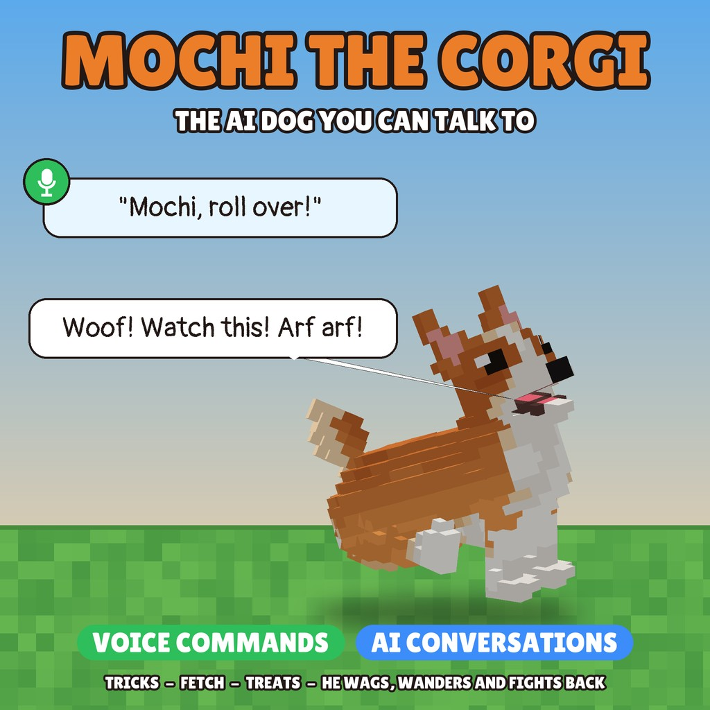

# Mochi the Corgi

**The AI dog you can talk to** - a global mod for [Teardown](https://teardowngame.com).

A fluffy corgi joins you in any level. Talk to him out loud or in the chat, and he understands you, answers in his
own speech bubbles, and does what you ask.

## Voice commands

- Say it: *"Mochi, sit!"*, *"roll over"*, *"bang!"*, *"spin"*, *"shake"*, *"jump"*, *"beg"*, *"fetch!"*,
  *"follow me"*, *"stay"*, *"come here"*...
- He understands normal sentences, not only keywords: *"sit down, then roll over and play dead"* - he does all three,
  in order.
- Speak into your microphone (speech to text through [Koetama](https://github.com/AgeOfAlgorithms/koetama)) or type in
  the chat.

## AI conversations

- Ask him anything: he chats back in character, a happy, slightly dramatic puppy.
- He knows what's going on around him: who is near, his health, that you just threw his ball, petted him, fed him or
  hurt him.
- He decides for himself when to join a conversation, when to ignore chatter that isn't about him, and when to run away
  scared.
- His replies are speech bubbles with a babble voice, heard by everyone nearby like any player's.

## Everything else

- **Fetch**: pick his ball up with **E**, throw it from your tool wheel; it bounces, he brings it back.
- **Treats**: a bag of dog treats in your tool wheel (or **H**).
- **Petting**: look at him, press **E**: tail wags, butt wiggles, hearts.
- He wanders off sniffing when nobody pays attention, comes when you call his name, and turns toward loud bangs.
- **Health**: hurt him and he bites back; only the host can order him to attack. A fresh Mochi comes back 30 s after
  he dies.

## Requirements

- [Proximity Comms (Text and Voice Chat)](https://steamcommunity.com/sharedfiles/filedetails/?id=3812301496)
  ([source](https://github.com/AgeOfAlgorithms/teardown-prox-text-chat-mod)): Mochi hears and speaks through its AI
  characters API.
- For AI conversations, the **host** runs [Koetama](https://github.com/AgeOfAlgorithms/koetama) with a language model
  set up (their own API key - OpenAI, Anthropic, DeepSeek, ... - or a local model) and allowed for Teardown. Other
  players need nothing for that. Without it Mochi still obeys plain commands, with woofs instead of words.
- For voice, whoever speaks needs Koetama for speech to text; typing works for everyone.

**AI notice:** Mochi's replies are written live by an AI model. What players say near him is sent to the AI service
the host chose in Koetama.

## Install

From the Steam Workshop, or clone this repository into `Documents/Teardown/mods/mochi the corgi` and enable it (and
Proximity Comms) as global mods.

## License

MIT. Made by AgeOfAlgorithms and Claude.
